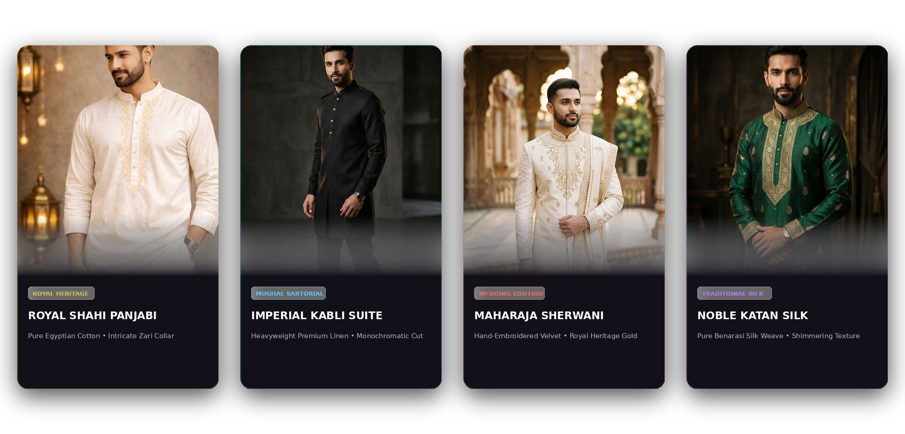

<div align="center">

# 👑 NAWABIYAAT — Royal Panjabi & Menswear Atelier
### Luxury Islamic Heritage Sartorial E-Commerce Engineered with Next.js 16 & Turbopack

[](https://nawabiyaat.pages.dev/)
[](https://nextjs.org/)
[](https://react.dev/)
[](https://www.typescriptlang.org/)
[](https://tailwindcss.com/)
[](https://nawabiyaat.pages.dev/)
[](LICENSE)

<br/>

**[⚡ View Live Production Deployment](https://nawabiyaat.pages.dev/)** &nbsp;•&nbsp; **[📦 GitHub Repository](https://github.com/labibfohayer/NAWABIYAAT-Fasion-Website)**

<br/>



</div>

---

## 📌 Architectural Overview

**NAWABIYAAT (নবাবীয়াত)** is an ultra-luxury menswear atelier and e-commerce web platform celebrating royal Mughal sartorial craftsmanship. Specializing in bespoke Panjabis, imperial Kabli suites, wedding Sherwanis, and handcrafted Benarasi Katan silk, the platform merges heritage grandeur with modern digital retail excellence.

Engineered with **Next.js 16 (App Router)**, **React 19**, and **Tailwind CSS v4**, the platform provides an instantaneous luxury shopping experience with dynamic sizing charts, multi-category collection filtering, and seamless cart operations.

---

## ⚡ Key Engineering Highlights

1. **Imperial Sartorial Showcase:**
   - 4 Royal Collection tiers: Egyptian Cotton Shahi Panjabi, Imperial Linen Kabli, Maharaja Wedding Sherwani, and Handwoven Benarasi Katan.
   - High-fidelity zoom inspection revealing fabric thread counts, zari collar embroidery, and mother-of-pearl buttons.

2. **Turbopack Build Architecture:**
   - Sub-second incremental compilation with Turbopack in Next.js 16.
   - Pre-rendered static routes for instant client navigation and zero layout shift.

3. **Integrated Order & Inquiry Engine:**
   - Instant slide-over luxury shopping bag with dynamic subtotal and direct concierge checkout flow.

---

## 🛠️ Tech Stack & Production Architecture

| Layer | Technologies | Purpose |
| :--- | :--- | :--- |
| **Framework** | Next.js 16 (App Router), React 19, TypeScript | Server components, Turbopack incremental builds |
| **Styling** | Tailwind CSS v4, Custom Shahi Gold Palettes | Regal color palette (`#D4AF37`, `#1A181B`) and typography |
| **State Management**| React Context, Local Storage Sync | Persistent luxury cart and filter states |
| **Deployment** | Cloudflare Pages, Global Edge Network | Sub-50ms static delivery across 300+ edge locations |

---

## 🚀 Getting Started & Local Development

```bash
# Clone the repository
git clone https://github.com/labibfohayer/NAWABIYAAT-Fasion-Website.git
cd NAWABIYAAT-Fasion-Website

# Install dependencies
npm install

# Start Next.js development server
npm run dev
```

Open [http://localhost:3000](http://localhost:3000) to view the live store.

---

## 📄 License
This project is open-source and distributed under the [MIT License](LICENSE).
